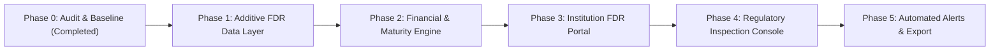

# SIH26265 Project Audit & Architecture Alignment Report
**Target Problem Statement:** SIH26265 — *Streamline of Security Deposit / FDR Portal*  
**System Architecture:** Next.js 15 (App Router) • React 19 • TypeScript • Tailwind CSS v4 • Prisma ORM • PostgreSQL  
**Audit Timestamp:** 2026-10-27  
**Author:** Senior Next.js Architect & Regulatory Workflow Engineer  

---

## Executive Summary

This audit evaluates the codebase to establish a baseline for **SIH26265: Streamline of Security Deposit/FDR Portal**. 

The current repository contains an **Educational Institution Affiliation & Regulatory Compliance Platform** with an interactive multi-step wizard, physical infrastructure/faculty validation utilities, and an administrative split-screen scrutiny inspection dashboard.

### Core Audit Finding & Non-Negotiable Domain Boundary
* **Current Business Domain**: Institutional Affiliation (Land area, Classrooms/Laboratories square meters, Faculty roster qualifications, and 1:20 Faculty-Student Ratio).
* **Target Business Domain (SIH26265)**: Fixed Deposit Receipt (FDR) / Security Deposit lifecycle management, bank verification evidence, tenure/maturity tracking, automated renewals, lien confirmation, release requests, and immutable audit logs.
* **Architectural Strategy**: In compliance with the non-negotiable safeguards, **we will not delete, rename, or rewrite existing affiliation models**. Instead, the FDR domain will be integrated **additively**:
  * The existing `Institution` and `User` models serve as the natural legal parent entity pledging FDRs.
  * The existing `Application` model represents statutory affiliation dossiers that mandate security deposits.
  * Dedicated FDR models (`FdrRecord`, `FdrDocument`, `FdrLifecycleEvent`, `FdrReleaseRequest`) will attach seamlessly without breaking existing functionality.

---

## 1. Verified Current Architecture

### 1.1 Dependency & Runtime Stack
* **Framework**: Next.js `15.5.28` (App Router)
* **UI Runtime**: React `19.1.0` & React-DOM `19.1.0`
* **Language & Tooling**: TypeScript `5.9.3` (`allowImportingTsExtensions: true`, strict mode, `@/*` path aliases)
* **Styling**: Tailwind CSS `v4.0.0` with `@tailwindcss/postcss` and CSS variable theming
* **Database & ORM**: Prisma `6.19.3` (`@prisma/client` `6.19.3`) targeting PostgreSQL (`url = env("DATABASE_URL")`)
* **Test Runner**: Node.js `24.13.0` native test runner (`node --experimental-strip-types --test`)
* **Dev Server**: Turbopack enabled (`next dev --turbopack`)
* **Production Bundler**: Webpack via `next build`

### 1.2 File Tree & Inventory
```text
SIH 2026/
├── prisma/
│   ├── schema.prisma                           # Prisma schema (PostgreSQL datasource)
│   └── migrations/
│       └── 20261027000000_init/
│           └── migration.sql                   # Baseline PostgreSQL migration
├── src/
│   ├── app/
│   │   ├── favicon.ico
│   │   ├── globals.css                         # Tailwind CSS v4 root styling
│   │   ├── layout.tsx                          # Root HTML & body shell
│   │   ├── page.tsx                            # Landing & Applicant Portal
│   │   └── admin/
│   │       └── dashboard/
│   │           ├── page.tsx                    # Administrative Scrutiny Page
│   │           ├── DashboardClient.tsx         # Split-screen inspection canvas
│   │           └── actions.ts                  # Server Actions for Application updates
│   ├── components/
│   │   ├── Header.tsx                          # Global responsive header navigation
│   │   ├── StatusCard.tsx                      # Summary KPI status badge card
│   │   └── ApplicationWizard.tsx               # 4-step applicant affiliation wizard
│   └── lib/
│       ├── compliance.ts                       # Regulatory validation algorithms (FSR, Area)
│       ├── db.ts                               # PrismaClient singleton instance
│       ├── utils.ts                            # Tailwind class merger & date formatting
│       └── __tests__/
│           └── compliance.test.ts              # 13 unit tests for compliance rules
├── .env / .env.example                         # Environment configuration
├── package.json                                # Scripts and dependencies
└── tsconfig.json                               # Strict compiler configuration
```

---

## 2. Existing Routes, Models, and Data Flows

### 2.1 Active Routes
1. **`/` (Applicant Portal)**:
   * **Component**: Embedded [src/components/ApplicationWizard.tsx](file:///c:/Users/Kishore/OneDrive/Desktop/SIH%202026/src/components/ApplicationWizard.tsx).
   * **Functionality**: Multi-step wizard collecting Institutional Profile, Infrastructure Rooms, and Faculty Inventory.
   * **Live Feature**: Real-time sticky sidebar evaluating 1:20 FSR and 1,000 $m^2$ built-up area thresholds as the user types.
2. **`/admin/dashboard` (Administrative Scrutiny Console)**:
   * **Component**: [src/app/admin/dashboard/DashboardClient.tsx](file:///c:/Users/Kishore/OneDrive/Desktop/SIH%202026/src/app/admin/dashboard/DashboardClient.tsx).
   * **Functionality**: Split-screen interface for scrutiny officers. Left panel inspects submitted institutional grids (facilities, faculties, norms). Right panel provides checklists to mark items as `Verified` or `Deficient`, write remarks, and commit status updates.

### 2.2 Verified Prisma Models (Existing)
* `User`: Primary identity model with `email`, `password_hash`, `role` enum (`applicant`, `scrutiny_officer`, `evc_inspector`, `admin`).
* `Institution`: Educational entity (`name`, `trustName`, `landAreaAcres`, `userId`).
* `Facility`: Physical spaces (`roomType`, `areaSqM`, `seatingCapacity`, `isBarrierFree`).
* `Faculty`: Teaching personnel (`panNumber`, `fullName`, `cadre`, `qualification`).
* `Application`: Regulatory submission tracking (`currentStatus`, `terChargesPaid`, `submissionDate`).

### 2.3 Authentication & Authorization Status
* **Current State**: Neither NextAuth, Auth.js, Clerk, nor session cookie middleware are installed.
* **Role Modeling**: The `Role` enum exists in Prisma, but route access control is currently open. Adding an authenticated role session gate is a prerequisite for production-grade regulatory portals.

---

## 3. Gap Analysis: Current Application vs. SIH26265 Requirements

| SIH26265 Requirement | Current Codebase Status | Gap & Proposed Realization |
| :--- | :--- | :--- |
| **FDR Record Repository** | ❌ None (Only physical facilities and faculties exist) | Add `FdrRecord` model (FDR No., issuing bank, branch, IFSC, principal amount, interest rate, issue/maturity dates, joint holder). |
| **Bank Verification Evidence** | ❌ None | Add `FdrDocument` model supporting verification letters, tripartite agreements, deposit scans, and branch manager confirmation. |
| **Joint Account & Lien Marking** | ❌ None | Add fields for joint holding (e.g. Regional Officer & Society President) and bank lien confirmation status. |
| **Maturity Deadlines & Alerts** | ⚠️ Partial (Area/FSR compliance engine exists) | Build dedicated `fdrCompliance.ts` engine: 30/60/90-day expiry windows, auto-renewal alerts, and minimum deposit validation. |
| **Renewals & Release Requests** | ❌ None | Add `FdrReleaseRequest` & `FdrRenewalRequest` models with approval workflows and compliance verification checks. |
| **Audit History & Logs** | ⚠️ Simulated in UI state | Add immutable `FdrAuditLog` capturing timestamped status transitions, officer identity, and verification notes. |
| **Split-Screen Inspection UX** | ✅ Reusable Pattern Exists | Repurpose the `/admin/dashboard` split-screen pattern for FDR verification (Left: Bank FDR details + document viewer; Right: Verification checklist & lien verification). |

---

## 4. What Can Be Reused Safely

1. **`Institution` Model & Relationships**:
   * Regulatory FDRs are never issued in a vacuum; they are pledged by an accredited Institution. Adding `Institution.fdrs FdrRecord[]` creates a clean, relational hierarchy without altering existing fields.
2. **`User` Model & Roles**:
   * The `Role` enum (`applicant`, `scrutiny_officer`, `admin`) maps directly to the FDR workflow: Institutions (applicants) upload FDRs, Scrutiny/Finance Officers verify them, and Admins grant release/renewal orders.
3. **Database Architecture (`src/lib/db.ts`)**:
   * The Prisma client singleton and database configuration are fully ready for additional schema extensions.
4. **Split-Screen Scrutiny UI Pattern**:
   * The layout in [src/app/admin/dashboard/DashboardClient.tsx](file:///c:/Users/Kishore/OneDrive/Desktop/SIH%202026/src/app/admin/dashboard/DashboardClient.tsx) is well-suited for FDR verification: inspecting bank credentials on the left while recording officer findings and lien checks on the right.
5. **Testing Architecture (`node:test`)**:
   * Native TypeScript test runner configuration can immediately test FDR financial calculations and maturity alert logic.

---

## 5. Missing FDR-Specific Components

### 5.1 Additive Prisma Models
```prisma
enum FdrStatus {
  PENDING_VERIFICATION
  ACTIVE_VERIFIED
  MATURING_SOON      // Within 60/30 days
  MATURED
  RENEWAL_REQUESTED
  RELEASE_REQUESTED
  RELEASED
  DEFICIENT
  FORFEITED
}

model FdrRecord {
  id                String             @id @default(uuid())
  institutionId     String
  institution       Institution        @relation(fields: [institutionId], references: [id], onDelete: Cascade)
  fdrNumber         String             @unique
  bankName          String
  branchName        String
  ifscCode          String
  amount            Float              // Principal amount in INR
  issueDate         DateTime
  maturityDate      DateTime
  tenureMonths      Int
  interestRate      Float
  jointHolderName   String             // Regulatory Authority Officer Name
  isLienMarked      Boolean            @default(false)
  status            FdrStatus          @default(PENDING_VERIFICATION)
  createdAt         DateTime           @default(now())
  updatedAt         DateTime           @updatedAt
  documents         FdrDocument[]
  releaseRequests   FdrReleaseRequest[]
  auditLogs         FdrAuditLog[]

  @@map("fdr_records")
}
```

### 5.2 Regulatory Calculation Engine (`src/lib/fdrCompliance.ts`)
* **Maturity Countdown & Alert Levels**:
  * `CRITICAL_30D`: $\le 30$ days to maturity.
  * `WARNING_60D`: $\le 60$ days to maturity.
  * `HEALTHY`: $> 60$ days.
  * `EXPIRED`: Past maturity date without recorded renewal.
* **Statutory Deposit Norms**:
  * Engineering/Tech: ₹35 Lakhs ($3,500,000$).
  * Pharmacy: ₹25 Lakhs ($2,500,000$).
  * Management: ₹15 Lakhs ($1,500,000$).
  * Compares total verified FDR amount against required statutory security deposit.

---

## 6. Baseline Verification & Test Results

Executed prior to any new phase implementations to establish an empirical baseline:

### 6.1 TypeScript Compilation (`npx tsc --noEmit`)
* **Status**: Passed
* **Errors**: `0`

### 6.2 Test Suite Execution (`npm test`)
* **Status**: Passed (13/13 tests)
* **Duration**: $328.77\text{ ms}$
* **Suites Verified**:
  * `Compliance Module - Faculty-Student Ratio (FSR)`: 7 tests passed.
  * `Compliance Module - Built-Up Area Validation`: 6 tests passed.

### 6.3 Next.js Production Build (`npm run build`)
* **Status**: Successful
* **Build Time**: $13.6\text{ s}$
* **Compiled Routes**:
  * `○ /` (Static, $6.52\text{ kB}$, First Load JS: $113\text{ kB}$)
  * `○ /_not-found` (Static, $993\text{ B}$, First Load JS: $104\text{ kB}$)
  * `○ /admin/dashboard` (Static, $7.24\text{ kB}$, First Load JS: $113\text{ kB}$)

---

## 7. Recommended Implementation Phases for SIH26265



### Phase 1: Additive FDR Data Model (Database Layer)
* Append `FdrRecord`, `FdrDocument`, `FdrReleaseRequest`, and `FdrAuditLog` to `prisma/schema.prisma`.
* Execute non-destructive migration script.
* Maintain existing `Facility`, `Faculty`, `Application` models in parallel without modification.

### Phase 2: Financial & Compliance Calculation Engine
* Create `src/lib/fdrCompliance.ts` to calculate statutory requirements, days to maturity, interest yields, and status thresholds.
* Write comprehensive unit tests in `src/lib/__tests__/fdrCompliance.test.ts`.

### Phase 3: Institution FDR Management Portal (`/fdr`)
* Build interactive interface allowing institutions to view active deposits, submit new FDR certificates, upload bank lien evidence, and initiate renewal/release requests.

### Phase 4: Regulatory Operations & Bank Verification Console (`/admin/fdr-dashboard`)
* Develop split-screen FDR inspection console:
  * Left: Bank confirmation letters, IFSC validator, deposit amount, and certificate scan.
  * Right: Bank lien verification toggle, interest compounding confirmation, deficiency notes, and official approval stamps.

### Phase 5: Automated Alerts, Audit Trail, & PDF Export
* Implement live notification center for upcoming maturities.
* Add printable/downloadable Regulatory Clearance Certificate for released deposits.

---

## Summary of Findings & Next Safe Step

1. **Findings**: The repository is stable, compiles with 0 errors, has 13 passing tests, and runs cleanly on Next.js 15. The existing codebase models institutional affiliation rather than FDRs.
2. **Preservation**: Existing models and routes will be preserved completely.
3. **Next Safe Implementation Step**: Proceed to **Phase 1** to add the additive Prisma schema definitions for `FdrRecord`, `FdrDocument`, and `FdrAuditLog` and generate the updated Prisma client.
