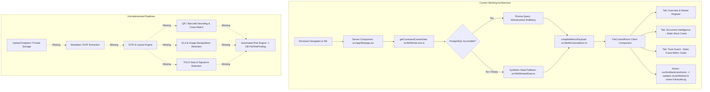
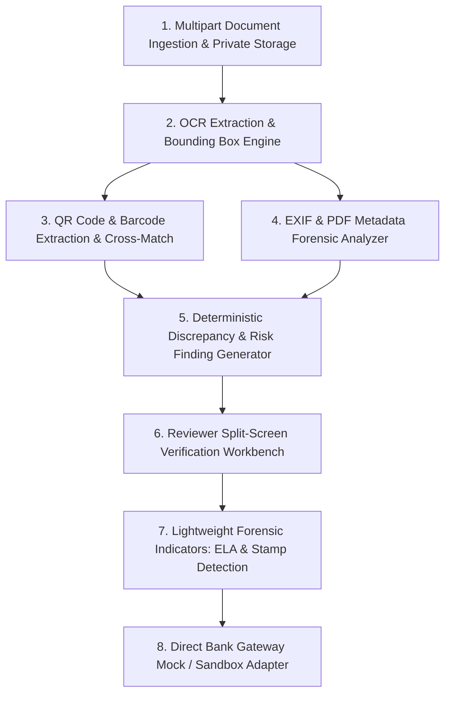

# FDR Guardian AI — Phase 2.5: AI-Powered Fraud Detection & Bank Verification Technical Audit

**Problem Statement:** Smart India Hackathon 2026 — SIH26265: "Streamline of security deposit / FDR portal"  
**Audit Target:** Digital Document Forensics, AI Fraud Detection, Physical Security Verification, and Direct Bank API Integration  
**Audit Type:** Read-Only Technical Audit (Non-Destructive)  
**Audit Timestamp:** 2026-10-27  
**Auditor Role:** Senior AI Engineer, Digital Forensics Engineer, Computer Vision Specialist, Financial Compliance Architect, and Cybersecurity Auditor  
**Primary Codebase:** Next.js 15 (App Router), React 19, TypeScript 5, Tailwind CSS 4, Prisma ORM 6.19.3, PostgreSQL  

---

## A. Executive Summary

A comprehensive, evidence-based code and architecture inspection of the repository was conducted to assess the readiness of **FDR Guardian AI** for advanced AI fraud detection, computer vision forensics, and bank verification integrations.

### Key Audit Findings:

1. **Relational Data Foundation & Reviewer Workbench are Production-Ready:**  
   The project has established a strong relational database foundation in [`prisma/schema.prisma`](file:///c:/Users/Kishore/OneDrive/Desktop/SIH%202026/prisma/schema.prisma#L98-L349) and a multi-tab Regulatory Operations Control Room in [`src/app/fdr/FdrControlRoom.tsx`](file:///c:/Users/Kishore/OneDrive/Desktop/SIH%202026/src/app/fdr/FdrControlRoom.tsx). Reviewers can inspect active certificates, filter portfolios, track maturities, confirm bank liens, register renewals, review release petitions, and inspect immutable audit logs.
   
2. **AI Forensics & Computer Vision Pipelines are Currently Absent:**  
   There is **no active implementation** of Error Level Analysis (ELA), EXIF/PDF metadata parsing, font alignment analysis, or computer vision object detection (YOLO/OpenCV) for bank seals and signatures. No Python runtime, OpenCV bindings, PyTorch/TensorFlow weights, or image processing libraries (`sharp`, `canvas`, `jimp`) exist in the project dependencies or filesystem.

3. **OCR Extraction & Physical Verification are Scaffolded / Mocked:**  
   The database schema includes models for `FdrDocument` and `DocumentExtraction` ([`prisma/schema.prisma:204-239`](file:///c:/Users/Kishore/OneDrive/Desktop/SIH%202026/prisma/schema.prisma#L204-L239)), and the control room UI renders OCR extraction confidence cards (e.g., "97.4% OCR Confidence" in `FdrControlRoom.tsx:902-935`). However, these fields are populated exclusively from synthetic seed datasets ([`src/lib/fdr/seedData.ts:407-471`](file:///c:/Users/Kishore/OneDrive/Desktop/SIH%202026/src/lib/fdr/seedData.ts#L407-L471)). No live OCR engine (e.g., Tesseract.js, Google Cloud Vision, Azure Document Intelligence) is installed or connected.

4. **Direct Bank Gateway Integration is Simulated / Mocked in UI:**  
   The top navigation includes a "Sync Banking Gateway ↺" control that refreshes state and displays a simulation toast ([`src/app/fdr/FdrControlRoom.tsx:220-233`](file:///c:/Users/Kishore/OneDrive/Desktop/SIH%202026/src/app/fdr/FdrControlRoom.tsx#L220-L233)), and the server action `confirmBankLienAction` ([`src/lib/fdr/service.ts:307-344`](file:///c:/Users/Kishore/OneDrive/Desktop/SIH%202026/src/lib/fdr/service.ts#L307-L344)) writes a verified state to the database. However, there are no external HTTP clients, bank API endpoints, SDKs, or banking credentials configured in the repository.

---

## B. Capability Matrix

| Capability | Primary Status | Evidence / File Paths | Tests or Verification | Main Gap |
|---|---|---|---|---|
| **EXIF & Document Metadata Analysis** | **NOT IMPLEMENTED** | [`package.json`](file:///c:/Users/Kishore/OneDrive/Desktop/SIH%202026/package.json#L15-L32) (no `exifr`, `pdf-parse`), [`prisma/schema.prisma:204-221`](file:///c:/Users/Kishore/OneDrive/Desktop/SIH%202026/prisma/schema.prisma#L204-L221) | Filesystem search yielded 0 metadata extraction functions | No metadata extraction pipeline or database schema fields for EXIF/PDF metadata. |
| **Error Level Analysis (ELA)** | **NOT IMPLEMENTED** | Repository root (0 Python scripts, 0 OpenCV/Pillow packages) | File search for `.py`, `.onnx`, `.pt`, `opencv`: 0 hits | No image recompression, error difference calculation, or heatmap visualization. |
| **Text Alignment & Font Consistency** | **NOT IMPLEMENTED** | [`src/lib/fdr/`](file:///c:/Users/Kishore/OneDrive/Desktop/SIH%202026/src/lib/fdr/) (no computer vision layout analyzer) | Code search for layout/font algorithms: 0 hits | No font geometry analysis, character spacing checks, or baseline anomaly detectors. |
| **Bank Seal & Stamp Detection** | **NOT IMPLEMENTED** | Repository root (0 model weight files, no YOLO/OpenCV) | Model search for `*.onnx`, `*.pt`, `*.weights`: 0 hits | No trained computer vision model to detect physical bank seals or official stamps. |
| **Signature Detection** | **NOT IMPLEMENTED** | Repository root (0 model weight files, no signature models) | Code search: 0 hits | No bounding box detection or presence verification for officer/bank signatures. |
| **QR / Barcode Decoding** | **NOT IMPLEMENTED** | [`package.json`](file:///c:/Users/Kishore/OneDrive/Desktop/SIH%202026/package.json) (no `jsqr`, `zxing`, `quagga`) | Code search: 0 hits | No image scanner to detect or decode 2D barcodes/QR codes from uploaded certificates. |
| **QR vs Printed Text Cross-Validation** | **NOT IMPLEMENTED** | [`src/lib/fdr/`](file:///c:/Users/Kishore/OneDrive/Desktop/SIH%202026/src/lib/fdr/) (no cross-matching logic) | Code search: 0 hits | Depends on QR decoding and OCR text extraction, neither of which is implemented. |
| **OCR & FDR Field Extraction** | **SCAFFOLDED / MOCKED** | [`prisma/schema.prisma:223-239`](file:///c:/Users/Kishore/OneDrive/Desktop/SIH%202026/prisma/schema.prisma#L223-L239), [`src/lib/fdr/seedData.ts:407-471`](file:///c:/Users/Kishore/OneDrive/Desktop/SIH%202026/src/lib/fdr/seedData.ts#L407-L471), [`src/app/fdr/FdrControlRoom.tsx:902-935`](file:///c:/Users/Kishore/OneDrive/Desktop/SIH%202026/src/app/fdr/FdrControlRoom.tsx#L902-L935) | UI displays static 97.4% confidence score; Schema and DTO contracts pass type checks | No real OCR engine executing on physical image or PDF buffers. |
| **Independent Bank Verification API** | **SCAFFOLDED / MOCKED** | [`src/app/fdr/FdrControlRoom.tsx:220-233`](file:///c:/Users/Kishore/OneDrive/Desktop/SIH%202026/src/app/fdr/FdrControlRoom.tsx#L220-L233), [`src/lib/fdr/service.ts:307-344`](file:///c:/Users/Kishore/OneDrive/Desktop/SIH%202026/src/lib/fdr/service.ts#L307-L344), [`.env.example`](file:///c:/Users/Kishore/OneDrive/Desktop/SIH%202026/.env.example) | UI button triggers simulated toast; `confirmBankLienAction` updates DB boolean | No external HTTP client, bank API gateway, or authorized institutional credentials. |
| **Risk & Discrepancy Engine** | **PARTIALLY IMPLEMENTED** | [`prisma/schema.prisma:315-328`](file:///c:/Users/Kishore/OneDrive/Desktop/SIH%202026/prisma/schema.prisma#L315-L328), [`src/lib/fdr/calculations.ts:42-45`](file:///c:/Users/Kishore/OneDrive/Desktop/SIH%202026/src/lib/fdr/calculations.ts#L42-L45), [`src/lib/fdr/seedData.ts:333-355`](file:///c:/Users/Kishore/OneDrive/Desktop/SIH%202026/src/lib/fdr/seedData.ts#L333-L355) | Tested via `src/lib/fdr/__tests__/fdrCalculations.test.ts` (19/19 tests pass) | Discrepancies exist as static synthetic seeds rather than being derived at document ingestion time. |
| **Persistent Findings & Reviewer Workbench** | **IMPLEMENTED AND VERIFIED** | [`src/app/fdr/FdrControlRoom.tsx`](file:///c:/Users/Kishore/OneDrive/Desktop/SIH%202026/src/app/fdr/FdrControlRoom.tsx), [`src/components/ui/DataTable.tsx`](file:///c:/Users/Kishore/OneDrive/Desktop/SIH%202026/src/components/ui/DataTable.tsx), [`src/lib/fdr/service.ts`](file:///c:/Users/Kishore/OneDrive/Desktop/SIH%202026/src/lib/fdr/service.ts) | Verified via `npm run build` (dynamic SSR route `/fdr`) | Relies on manual officer action or synthetic seed until ingestion pipeline is built. |
| **Audit Trail for Verification Outcomes** | **IMPLEMENTED AND VERIFIED** | [`prisma/schema.prisma:330-348`](file:///c:/Users/Kishore/OneDrive/Desktop/SIH%202026/prisma/schema.prisma#L330-L348), [`src/lib/fdr/service.ts:319-329`](file:///c:/Users/Kishore/OneDrive/Desktop/SIH%202026/src/lib/fdr/service.ts#L319-L329), [`src/app/fdr/FdrControlRoom.tsx:803-845`](file:///c:/Users/Kishore/OneDrive/Desktop/SIH%202026/src/app/fdr/FdrControlRoom.tsx#L803-L845) | Verified via `npm run build` and unit tests | Captures officer manual verification; external automated webhook signatures not yet modeled. |

---

## C. Existing Architecture & Processing Flow

The actual end-to-end flow currently operating in the codebase:

### 1. Document Ingestion & Storage Status:
- **No Document Upload Endpoint:** There is no `/api/upload` route handler or multi-part form Server Action in `src/app`.
- **No File Storage:** There is no disk storage directory (e.g. `uploads/` or `storage/`) or cloud object storage integration (S3/Azure Blob/GCS).
- **Static URLs in Seed Data:** The synthetic documents reference static strings such as `/documents/fdr-88210.pdf`, but no physical files exist at those paths in `public/`.

### 2. Analysis & Extraction Status:
- Extraction data exists only in TypeScript DTO structures ([`src/lib/fdr/types.ts:77-96`](file:///c:/Users/Kishore/OneDrive/Desktop/SIH%202026/src/lib/fdr/types.ts#L77-L96)) and synthetic fixtures ([`src/lib/fdr/seedData.ts:407-471`](file:///c:/Users/Kishore/OneDrive/Desktop/SIH%202026/src/lib/fdr/seedData.ts#L407-L471)).
- No processing pipeline is triggered when records are saved or reviewed.

### 3. Banking Integration Status:
- The UI contains buttons ("Sync Banking Gateway ↺") and tabs ("Trust Guard") designed to represent bank verification.
- Clicking the sync button triggers a client-side toast via `useToast()` and calls `router.refresh()`. It does not execute a network request to an external banking host.
- The `isLienMarked` field is a manual toggle executed by the scrutiny officer through the `ConfirmDialog` component.

---

## D. Detailed Implementation Gaps

### 1. EXIF and Document Metadata Forensic Analysis
- **Missing Packages:** No EXIF readers (`exifr`, `exiftool-vendored`, `pdf-parse`, `pdf-lib`).
- **Missing Database Columns:** `FdrDocument` lacks metadata fields (e.g. `cameraMake`, `softwareTool`, `creationDate`, `metadataAnomaliesJson`).
- **Forensic Principle Note:** In production, missing metadata cannot automatically be treated as proof of forgery, as institutional scanners or PDF optimizers frequently strip EXIF tags. The audit confirms no classification or explanation logic exists yet.

### 2. Error Level Analysis (ELA) & Image Manipulation Detection
- **Missing Pipeline:** No Python scripts, Pillow, or OpenCV bindings.
- **Missing Execution:** ELA requires saving an image at a known JPEG quality level (e.g., 90-95%), computing the absolute difference between pixel values, and scaling the result to generate a visual error matrix. This computation does not exist in any file.
- **Forensic Principle Note:** High ELA variance can occur naturally along high-contrast text edges or during normal resizing. The system must never claim ELA proves forgery, but rather use it as an unconfirmed forensic indicator.

### 3. Text Alignment and Font Consistency Analysis
- **Missing OCR Bounding Box Analysis:** Real font consistency analysis requires word-level or character-level bounding boxes (e.g., from Tesseract HOCR or Google Cloud Vision full text annotation) to measure baseline offsets, character height anomalies, and font weight variations.
- **Current Reality:** Only final text strings are represented in `DocumentExtraction`.

### 4. Physical Document Security (Seal, Stamp & Signature Detection)
- **Missing Models & Weights:** No `.pt`, `.onnx`, or `.tflite` files exist in the repository.
- **Missing Inference Engine:** No `@tensorflow/tfjs-node`, `onnxruntime-node`, or Python subprocess wrapper is installed.
- **Authenticity Boundary:** Detecting the presence of a circle stamp or ink signature does not verify its authenticity (a stamp can be scanned from a legitimate document and digitally pasted).

### 5. QR Code and Barcode Cross-Verification
- **Missing Decoding Engine:** No QR/barcode libraries (`jsqr`, `@zxing/library`) are present.
- **Missing Verification Logic:** No deterministic comparison function exists to parse an encoded string (e.g., `SBI|FDR|88210|3500000|2026-11-15`), compare it against OCR-extracted text, and flag mismatches in `FdrRiskFinding`.

### 6. Direct Bank API Integration
- **Missing Gateway Specification:** India's banking sector does not provide an open, standardized public API for third-party fixed deposit receipt verification. Official verification typically requires:
  - Account Aggregator (AA) framework (RBI regulated financial information providers), or
  - Core Banking System (CBS) integration via NPCI / SFMS / structured bank API partnerships (requiring corporate enterprise agreements and mutual TLS certificates), or
  - Public Financial Management System (PFMS) / Digilocker integration.
- **Current Configuration:** [`.env`](file:///c:/Users/Kishore/OneDrive/Desktop/SIH%202026/.env) contains only `DATABASE_URL`. No API keys, client certificates, or gateway endpoints exist.

---

## E. Recommended Implementation Order (Phase 3 Roadmap)

To evolve FDR Guardian AI from a scaffolding/control room prototype into an authentic, defensible verification platform, the following phased implementation sequence is recommended:

### Phase 3.1: Document Ingestion & Deterministic Integrity (Highest Priority, Lowest Risk)
1. **Private Document Storage:**
   - Create a Next.js Server Action or Route Handler (`/api/fdr/documents/upload`) supporting PDF and JPEG/PNG uploads.
   - Store files securely on disk or local blob store with UUID paths (never accessible via unauthenticated public URL).
2. **Metadata Forensic Analyzer:**
   - Add lightweight metadata extraction (e.g., using pure JS `exifr` or `pdf-parse`).
   - Extract creation date, modification date, and creator software (e.g., flagging software names like "Adobe Photoshop", "GIMP", or "Canva").
   - Store findings in a new `metadataJson` field on `FdrDocument`.

### Phase 3.2: OCR Extraction & QR Cross-Validation
3. **Deterministic OCR Pipeline:**
   - Integrate an OCR engine (e.g., Tesseract.js for local/offline processing, or cloud vision API if credentials become available).
   - Extract certificate number, issuing bank, IFSC, amount, and maturity date.
4. **QR Code Decoupled Verification:**
   - Add `jsqr` or `@zxing/library` to detect and decode QR codes from deposit certificate images.
   - Compare decoded fields directly with OCR fields and institution form inputs:
     - Flag *Mismatch between QR-encoded deposit amount and printed text* as a **CRITICAL** risk finding.
     - Flag *Mismatch between IFSC code and RBI clearing registry* as a **WARNING** finding.

### Phase 3.3: Image Manipulation & Forensic Diagnostic Indicators
5. **Node.js Canvas / Sharp ELA Pipeline:**
   - Implement Error Level Analysis using `sharp`: recompress input image at 90% JPEG quality, compute absolute pixel difference, amplify by scale factor (15-20x), and generate an ELA diagnostic preview.
   - Render the ELA preview in the Reviewer Dossier alongside clear legal disclaimer text:  
     *> "Forensic Indicator Note: ELA highlights compression anomalies and edge gradients. It is a decision-support aid and does not constitute proof of document forgery."*

### Phase 3.4: Bank Gateway & Lien Verification Architecture
6. **Standardized Bank Verification Gateway Interface:**
   - Define a typed TypeScript interface `BankVerificationGateway` with methods:
     - `verifyInstrument(fdrNumber, bankIfsc, principalAmount, jointHolder)`
     - `checkLienStatus(fdrNumber, ifsc)`
   - Implement a robust Sandbox / Mock Adapter simulating responses from SBI, HDFC, PNB, and Canara Bank nodes (including positive verification, lien confirmed, amount mismatch, and instrument not found).
   - Include error handling for network timeouts and unavailable banking gateways.

---

## F. Hackathon Demonstration Feasibility

| Capability | Demonstration Feasibility Today | What is Required to Demonstrate |
|---|---|---|
| **Regulatory Control Room & Portfolio Monitoring** | **100% FEASIBLE (Ready Today)** | Fully operational. Displays total pledged capital, countdown to 30D/60D maturities, active vs expired certificates, and responsive search. |
| **Reviewer Lien Verification Workflow** | **100% FEASIBLE (Ready Today)** | Fully operational. Officers can click "Verify Lien", review confirmation details in modal dialog, and persist status with audit log entries. |
| **Audit Ledger & Historical Lineage** | **100% FEASIBLE (Ready Today)** | Fully operational. Captures actors, actions, timestamps, and preserves predecessor certificate history without overwriting. |
| **OCR Field Comparison Display** | **FEASIBLE AS SIMULATED DEMO** | UI displays synthetic extracted fields. Requires Phase 3.2 implementation to process live user-uploaded files. |
| **QR Code Cross-Validation** | **HIGH FEASIBILITY (Phase 3.1)** | Can be demonstrated with high reliability once pure JS `jsqr` is added, using sample FDR certificates with genuine embedded QR payloads. |
| **EXIF Software Metadata Flagging** | **HIGH FEASIBILITY (Phase 3.1)** | Can be demonstrated quickly with `exifr`, showing detection of editing tools (Photoshop, Canva) on modified test certificates. |
| **Error Level Analysis (ELA)** | **MEDIUM FEASIBILITY (Phase 3.3)** | Can be implemented in pure Node using `sharp`, generating visual ELA heatmaps directly in the reviewer dossier. |
| **Live External Bank CBS API** | **NOT FEASIBLE WITHOUT OFFICIAL BANK MOUS** | Real commercial banks require formal bilateral agreements, RBI sandbox licensing, or corporate SFMS access. Must be demonstrated via an **Official Bank Gateway Sandbox Adapter**. |

---

## G. Next-Step Recommendation

### Recommended Immediate Milestone:
**Phase 3.1 — Document Ingestion, EXIF Forensics & QR Cross-Validation Engine**

Implement the deterministic, highly defensible components first before attempting complex computer vision models:
1. Build private document upload endpoint supporting PDF and images.
2. Add EXIF/PDF metadata extraction to flag editing software and timeline anomalies.
3. Add QR code detection and decoding to perform 100% deterministic cross-verification against entered certificate numbers and amounts.
4. Integrate an official **Bank Gateway Sandbox Provider** that implements realistic bank response protocols, latency simulation, and lien confirmation certificates.
