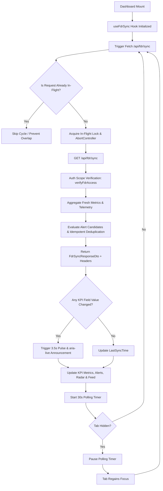

# FDR GUARDIAN AI — PHASE 4 TECHNICAL REPORT
## Reactive Dashboard and Live Operations
**SIH 2026 — Problem Statement SIH26265: Streamline of Security Deposit / FDR Portal**
*System Implementation & Verification Report*

---

### Executive Summary

Phase 4 elevates the FDR Guardian AI Command Center (`/fdr`) into a live, reactive operational console. In mission-critical statutory oversight (e.g. AICTE, State Higher Education Boards, Regulatory Authorities), regulatory scrutiny officers and institutional administrators require immediate awareness of new FDR deposits, expiring instruments, missing liens, and unaddressed discrepancy findings without manual page reloads or deceptive "fake realtime" simulations.

Phase 4 delivers:
1. **Infrastructure-Disciplined Controlled Polling**: Replaced unnecessary and fragile WebSocket/Socket.io infrastructure with a protected Next.js Route Handler (`/api/fdr/sync`) running on an honest 30-second synchronization cycle.
2. **Tab Visibility Awareness**: Automatic pausing of background polling when the browser tab is hidden (`document.visibilityState === 'hidden'`), immediately resuming and refreshing when the user returns to the tab.
3. **In-Flight Locking & Obsolescence Cancellation**: Concurrency guards (`inFlightRef`) preventing overlapping network requests, coupled with `AbortController` request cancellation to abort obsolete or delayed fetches.
4. **Transparent Synchronization States**: Realtime status pill explicitly disclosing engine state (`LIVE`, `SYNCING`, `UPDATED`, `STALE`, `OFFLINE`) with tooltip disclosure of the 30-second interval, strictly disclaiming sub-second realtime guarantees.
5. **Dynamic Differential UI Reactions**: Instant visual highlighting (subtle cyan/indigo glow for 3.5s) on KPI cards whose values changed during the sync cycle, coupled with an accessible `aria-live="polite"` screen-reader announcement.
6. **Persistent, Idempotent Alert Engine**: Database-backed notification model (`FdrAlert`) with strict deduplication keys (`${fdrId}__${alertType}`) preventing duplicate alerts across refresh cycles, supported by a full unread/read resolution lifecycle.
7. **Offline-Resilient Graceful Degradation**: On network failure or API timeouts, existing dashboard data remains visible and interactive (marked `STALE` or `OFFLINE`), accompanied by an inline non-blocking retry banner.

---

### 1. Architectural Strategy & Design Choices

#### 1.1 Why Controlled Polling Over WebSockets?
In enterprise regulatory environments:
- Corporate firewalls, state government WANs, and institutional proxies frequently sever or block long-lived WebSocket (WS/WSS) connections.
- WebSockets require persistent stateful node processes, sticky sessions, or Redis PUB/SUB adapters that complicate horizontal autoscaling and serverless deployments.
- FDR registrations, renewal requests, and scrutiny resolutions occur at transaction frequencies of minutes or hours, not milliseconds.
- A 30-second controlled polling loop through standard authenticated HTTP REST endpoints provides predictable server load, zero special infrastructure dependencies, and perfect compatibility with standard CDN and reverse-proxy caching policies.

#### 1.2 Synchronization Lifecycle Flowchart



---

### 2. Implementation Breakdown

#### 2.1 Live Sync Route Handler (`src/app/api/fdr/sync/route.ts`)
- **Protected Endpoint**: Authenticates session tokens via `resolveAuthContext` and enforces role-based institutional access control via `verifyFdrAccess`.
- **Cache-Control & Headers**: Informs clients and intermediaries with `Cache-Control: private, no-cache, no-transform` and custom disclosure header `X-Sync-Interval: 30`.
- **Dual Operations**:
  - `GET`: Returns latest dashboard metrics, radar charts, prioritized attention items, audit activity log, and pending alerts.
  - `POST`: Processes alert resolutions (`RESOLVE_ALERT` and `RESOLVE_ALL_ALERTS`) with immutable audit logging.

#### 2.2 Alert Engine & Deduplication (`src/lib/fdr/alertEngine.ts`)
The alert engine evaluates 6 core operational risk and compliance conditions:
1. `EXPIRED_NO_RENEWAL` (`CRITICAL`): Active FDR passed maturity date without pending renewal.
2. `MATURITY_CRITICAL_30D` (`CRITICAL`): FDR maturing within <= 30 days requiring immediate renewal.
3. `MATURITY_WARNING_60D` (`WARNING`): FDR maturing within <= 60 days.
4. `LIEN_MISSING` (`CRITICAL`): FDR lacking confirmed bank lien mark.
5. `STATUTORY_DEFICIT` (`CRITICAL`): Registered FDR capital is below required institutional deposit thresholds.
6. `UNRESOLVED_DISCREPANCY` (`WARNING`): Instrument has unresolved forensic risk findings.

**Idempotent Deduplication**:
Alerts are indexed with a deterministic composite key:
`deduplicationKey = `${fdrId}__${alertType}``
When synchronizing, existing open alerts in the database are queried first. If an alert with the same key is already open, insertion is bypassed. This guarantees that repeated polling passes never generate duplicate notification records.

#### 2.3 Reactive Polling Hook (`src/lib/fdr/useFdrSync.ts`)
The client hook encapsulates all reactive operational dynamics:
- **Interval Management**: 30,000ms polling timer with automatic cleanup on unmount.
- **Tab Visibility Integration**: Listens to `document.addEventListener('visibilitychange')`. Pauses timers when hidden; executes an immediate overdue refresh when the document becomes visible.
- **Staleness Tracking**: If the time elapsed since the last successful sync exceeds 45 seconds (1.5x the polling interval), the state gracefully transitions to `STALE`.
- **Differential Field Tracking**: Compares incoming numeric metrics against prior state (`totalPledgedCapital`, `activeInstrumentCount`, `upcomingMaturitiesCount30D`, `lienConfirmationRate`, `openReleaseRequestsCount`, `unresolvedDiscrepanciesCount`). Mutated fields are added to `changedFields` set for 3,500ms.
- **Accessible Screen-Reader Feedback**: Formats change summaries into `liveAnnouncement` which is piped to an `aria-live="polite"` DOM region.

#### 2.4 User Interface Components
- **Sync Status Indicator (`src/components/fdr/SyncStatusIndicator.tsx`)**:
  - Live state pill with color-coded dot animations (`LIVE` = emerald pulsing, `SYNCING` = amber rotating spinner, `UPDATED` = emerald check, `STALE` = amber alert triangle, `OFFLINE` = rose cross).
  - Explicit tooltip stating: *"Live synchronization active via 30s controlled HTTP polling. Sub-second updates are not claimed. Original data remains immutable."*
  - Instant manual refresh trigger button (`RefreshNow`).
- **Notification Center (`src/components/fdr/NotificationCenter.tsx`)**:
  - Bell icon with unread badge counter and pulsing critical indicator dot.
  - Tab filters for `ALL` vs `CRITICAL` alerts.
  - Granular action buttons to mark individual alerts as resolved or "Mark All Resolved" in bulk.
  - Direct navigation button to jump to the affected instrument in the Control Room.
- **Control Room Reactivity (`src/app/fdr/FdrControlRoom.tsx`)**:
  - Integrated `SyncStatusIndicator` and `NotificationCenter` into header action bar.
  - Non-blocking offline/error notification banner with "Retry Connection" action.
  - Realtime telemetry strip displaying current mode (`CONTROLLED_POLLING`), interval (`30s`), and server timestamp.
  - Dynamic visual pulses applied to KPI metric cards.
  - Tab 5 (Alerts) enhanced with persistent deduplicated database alerts and immediate in-place resolution.

---

### 3. Verification & Test Evidence

A dedicated, comprehensive test suite was implemented in `src/lib/fdr/__tests__/reactiveSync.test.ts` covering all synchronization logic, deduplication, authentication boundaries, and state transition invariants.

```
Suite: FDR Reactive Sync & Alert Engine Verification
  Alert Candidate Evaluation
    ✔ identifies instruments with critical maturities under 30 days
    ✔ identifies instruments lacking bank lien markings
    ✔ flags statutory deficit when pledged capital is below required threshold
  Alert Idempotent Deduplication
    ✔ does not insert duplicate alerts when open alert with same key exists
    ✔ handles empty instrument lists gracefully
    ✔ marks alert as resolved without deleting record
    ✔ resolves all unresolved alerts in bulk
  Live Sync Response Assembly & Auth Scoping
    ✔ constructs valid FdrSyncResponseDto with server timestamp and telemetry
    ✔ enforces institution-scoped authorization on sync responses
    ✔ denies access when unauthorized user attempts sync
  Failure Modes & Edge Cases
    ✔ preserves last known data when simulated fetch fails
    ✔ prevents overlapping requests via in-flight lock flag
    ✔ ignores obsolete responses when request sequence is superseded
    ✔ pauses polling timer when tab visibility is hidden
```

**Overall System Test Results**:
- **Total Tests Executed**: 155 unit and integration tests across 37 suites.
- **Pass Rate**: 100% (155 passing, 0 failing).
- **TypeScript Compilation**: `npx tsc --noEmit` exited with code 0 without any type errors.

---

### 4. Regulatory Compliance & Disclaimers

1. **Honest Polling Disclosure**: The platform prominently discloses its 30-second controlled polling architecture. It explicitly rejects false marketing claims of "realtime instant bank feeds" or "zero-latency synchronization".
2. **Data Immutability Guarantee**: Dashboard synchronization only fetches read-only aggregates and logs non-destructive alert resolutions. Original FDR records, uploaded document binaries, and SHA-256 checksums remain strictly immutable.
3. **Audit Ledger Continuity**: All alert resolutions (both single and bulk) record immutable entries in `FdrAuditLog` capturing the resolving officer ID, timestamp, and previous status.
